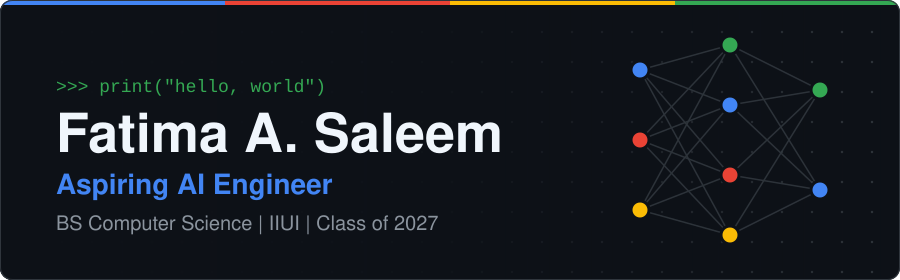
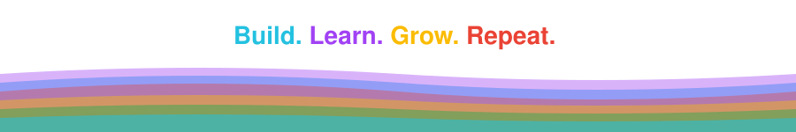

<div align="center">



<a href="https://github.com/Fatimaaasaleem">
  
</a>

</div>

<br>

## 👋 About Me

I'm a BS Computer Science student (class of 2027) working toward a career as an AI engineer. I like understanding how things actually work, trying ideas out, and learning by building.

Right now I'm building a machine learning classifier for air quality as an internship project, and prototyping a Retrieval-Augmented Generation pipeline on the side. I learn through small, honest experiments that I improve step by step.

```python
class Fatima:
    studying   = "BS Computer Science, class of 2027"
    aiming_for = "AI Engineer"
    building   = ["Air quality classifier (internship)", "RAG prototype (in progress)"]
    exploring  = ["LLM apps", "AI agents", "computer vision"]
    approach   = "experiment, break it, understand it, repeat"
```

<div align="center"></div>

## 🧰 Technical Skills

**Languages & Data**<br>


**Machine Learning**<br>


**LLMs & Retrieval** *(learning)*<br>


**Tools**<br>


<div align="center"></div>

## 🚀 Featured Projects

### [Machine Learning-Based Air Quality Classification System](https://github.com/Fatimaaasaleem/air-quality-classification)


An ongoing machine learning project investigating how pollutant measurements can be used to classify air quality into six categories.

**Current work:**
- 🔍 Dataset evaluation
- 🧪 Data-quality investigation
- 🛠️ Preprocessing experiments
- 🎯 Establishing a reliable classification baseline


<br>

### 🧬 RAG Prototype *(experimental)*


A learning project exploring Retrieval-Augmented Generation: document chunking, embeddings, a FAISS vector index, and an LLM API to answer questions over documents. Still being built, not a finished application.


<div align="center"></div>

## 🌱 Currently Learning

- 🤖 **LLM applications and RAG**: building retrieval pipelines that give grounded answers
- 🕹️ **AI agents and automation**: connecting models to tools and workflows
- 👁️ **Computer vision**: understanding how machines work with images
- 🔁 **Reusable, reliable ML pipelines**: moving from one-off notebooks to repeatable workflows

<div align="center"></div>

## 📊 GitHub Statistics

<div align="center">


</div>

<div align="center"></div>

## 💬 Connect

[](https://github.com/Fatimaaasaleem)
[](https://www.linkedin.com/in/fatima-saleem-3946772a5)

<div align="center">



</div>
